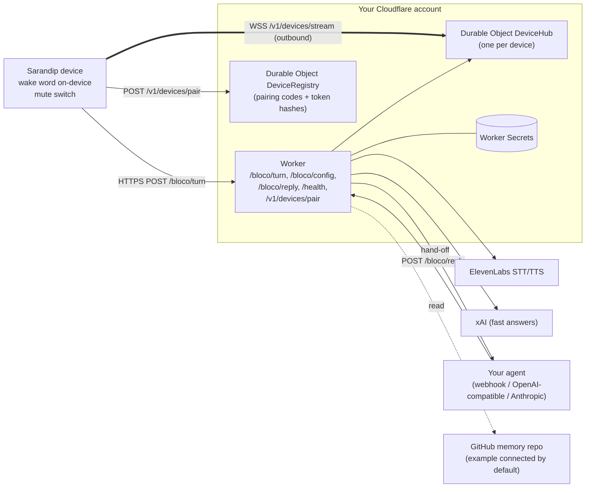

# Sarandip Casa: voice server

Sarandip is a small open voice device: an ESP32-S3 with an INMP441 microphone, a MAX98357A amplifier, a wake word detected on the device, and a physical mute switch. This repository holds the **voice server** for the home version. It runs as a **Cloudflare Worker with Durable Objects in your own Cloudflare account**, using **your own API keys**.

What it does:
- **Fast answers.** After the wake word (or the push-to-talk button), the device uploads the question over HTTPS. The server transcribes it (ElevenLabs STT), answers with a fast LLM (xAI), and streams back speech (ElevenLabs TTS).
- **Hand-off to your agent.** When a question needs tools, such as your calendar, email, tasks or live data, the server says a short "on it" message. It then forwards the question to the agent you already use, for example a Grok Bot routine through a webhook, an OpenAI-compatible or Anthropic API, or any service that accepts a webhook (including OpenClaw). The agent's answer comes back later and is spoken through a WebSocket that the device keeps open. The device never opens an inbound port.
- **Memory.** The server can read a short profile from a GitHub repository. By default it is connected to the fictional example repository `luciocs/jarvis-memory-demo`. You can skip memory, or point it at a repository you own (read-only).
- **Local date and time on every turn.** The current date, weekday and time are computed in the time zone you configure (`TZ`, default `UTC`) and given to the model and to your agent.

## Architecture



Wire protocol: `sarandip-ws-1`, documented in [`PROTOCOL.md`](PROTOCOL.md). The previous name `luva-ws-1` is still accepted on WebSocket `hello`.

## Privacy

- **The device listens only after the wake word or the button.** There is no ambient listening in the home version. The firmware locks it off, and the server cannot turn it on. The mute switch is a hardware input: with mute on, nothing is captured and late answers are discarded.
- **Your secrets stay in your account.** API keys live only as Worker Secrets in your Cloudflare account. They are never in this repository, never in the firmware, and never sent to the Sarandip project.
- **Device-side decisions (20/11/2026).** The setup network `Sarandip-Setup` is **open** (no WPA2); it exists only while setup mode is open (first boot, factory reset, or the owner's gesture: 5 quick flips of the mute switch, or BOOT held 10 seconds), and the microphone is off during setup. The device token is stored in the device's NVS **without encryption** (no eFuse burning, no flash encryption); someone with physical USB access could read it, and the mitigation is revoking the device on this server. Factory reset is holding BOOT for **25 seconds**, or 10 quick flips of the mute switch. The public wake word is **"Hey Jarvis"** (`hey_jarvis`); `okay_nabu` and `hey_mycroft` are build-time alternatives. Details: `docs/security.md`.
- **Device tokens are hashed.** The server stores only their SHA-256 and compares them in constant time. The raw token is returned once, in the pairing response, and is never logged.
- **Memory is on by default**, pointed at a fictional example profile. Anyone who talks to the device may hear what is in the configured memory. Skip it with `MEMORY_ENABLED=false`, or use a dedicated repository with nothing sensitive in it. A public repository is read without a GitHub token; a private one needs a fine-grained token limited to that repository.
- **Logs carry no audio and no text.** Logs contain error classes and counters only: no audio, transcripts, answers or tokens. Transcripts go to the model providers you configured and, on hand-off, to your agent. The server does not store them beyond the short conversation context kept in the device's Durable Object.

## Requirements

- A **Cloudflare account**. Workers and Durable Objects with SQLite storage are used. Check the current plan limits for your expected usage.
- An **xAI API key**, for fast answers.
- An **ElevenLabs API key**, for speech-to-text and text-to-speech, plus a voice id you like.
- Optional: a **GitHub fine-grained token**, only if your memory repository is private. It should give access to *only one repository*, with *Contents: Read-only* (*Metadata: Read-only* is added automatically) and nothing else. The default example repository is public and is read without a token.
- Optional: an **agent** for hand-off (HTTPS webhook, OpenAI-compatible API, or Anthropic).
- A Sarandip device (ESP32-S3 N16R8, INMP441, MAX98357A, 8-LED ring, mute switch) running the Sarandip Casa firmware (sibling package `../sarandip-casa-firmware`, Apache-2.0). Setup is a captive portal plus a pairing code: the owner steps are in `../sarandip-casa-firmware/docs/device-setup.md`; the server side is in `docs/device-setup.md`.

## Quick start (agent-driven)

Point your Grok Bot, or any coding agent with Cloudflare access, at this repository and say:

> **"Set up my Sarandip server."**

The agent follows [`AGENT.md`](AGENT.md). The steps are:
1. It checks your Cloudflare account.
2. It deploys the Worker and the Durable Objects.
3. It generates the internal secrets locally.
4. It asks you for **only** your API keys, through a protected field and never in chat.
5. It walks you through memory (connected by default; you may skip it) and, if you want, your agent.
6. It runs the tests.
7. It gives you a **pairing code** to type on the device's setup page (short-lived, or a printed claim code bound to that device).

## Manual setup

```bash
git clone https://github.com/luciocs/sarandip-casa-server.git && cd sarandip-casa-server
npm install
npm test                 # unit + integration tests with stubs, no network
npm run typecheck
cp wrangler.example.toml wrangler.toml   # gitignored; set name, voice id, TZ, LANGUAGE
# Optional: PUBLIC_BASE_URL. If you leave it empty, the Worker uses the request origin.
npx wrangler login
npx wrangler deploy -c wrangler.toml

# Secrets: each command prompts for the value; nothing is echoed or saved in the repo
npx wrangler secret put XAI_API_KEY
npx wrangler secret put ELEVENLABS_API_KEY
npx wrangler secret put REPLY_SECRET      # long random string; your agent uses it on POST /bloco/reply
npx wrangler secret put ADMIN_TOKEN       # long random string; protects pairing-code issuance
# Optional:
# npx wrangler secret put WEBHOOK_URL
# npx wrangler secret put WEBHOOK_TOKEN
# npx wrangler secret put GITHUB_TOKEN          # only for a private memory repo
# npx wrangler secret put REPLY_SECRET_PREVIOUS # during rotation
# npx wrangler secret put DEVICE_TOKENS         # legacy fallback; prefer pairing
# npx wrangler secret put OPENAI_API_KEY        # ROUTINE_PROVIDER=openai
# npx wrangler secret put ANTHROPIC_API_KEY     # ROUTINE_PROVIDER=anthropic
# npx wrangler secret put FIRMWARE_SIGNING_KEY  # PKCS#8 PEM; signs OTA images

curl https://<your-worker>.<your-subdomain>.workers.dev/health
```

Then pair the device. See `docs/device-setup.md` and `PROTOCOL.md` §2. Short-lived codes (`POST /v1/admin/pairing-codes`, optional `ttl_s`) expire in 10 minutes by default. For a code that ships in the box, issue a claim code with `{"device_id":"sc-…","permanent":true}`: it never expires, works only for that device, and can be reused after a factory reset; `DELETE` or a re-issue rotates it.

### Deploy to Cloudflare button

[](https://deploy.workers.cloudflare.com/?url=https://github.com/luciocs/sarandip-casa-server)

Verification against [Cloudflare's Deploy to Cloudflare buttons docs](https://developers.cloudflare.com/workers/platform/deploy-buttons/) (fetched 20 November 2026):

- The button clones the public source repo, provisions supported resources (including **Durable Objects**) from the Wrangler config, and deploys with Workers Builds.
- **Secrets** are taken from `.dev.vars.example` (dotenv) and shown in the dashboard for the deployer to fill in. Binding descriptions live under `cloudflare.bindings` in `package.json`.
- The official docs say Cloudflare reads "the Wrangler configuration file" of the source repo (`wrangler.toml` / `wrangler.jsonc`). This project ships `wrangler.example.toml` and gitignores a local `wrangler.toml`, so an `account_id` or a personal URL cannot be committed by mistake. A committed, account-free `wrangler.toml` is intentionally not included. The Deploy button may therefore not read the example file automatically; use the manual setup (`cp wrangler.example.toml wrangler.toml`) or point your agent at this repository.
- Durable Object migrations in this package use the legacy `[[migrations]]` array: tag `v1` (`DeviceHub`, `DeviceRegistry`) and tag `v2` (`FirmwareStore`). As of June 2026 Cloudflare also offers a declarative `exports` map; this package keeps `migrations` so a first-time `wrangler deploy` (and the current test plugin) apply the SQLite classes. `exports` and `migrations` must not be mixed.
- Private repositories are not supported by the button.
- Limitations: GitHub/GitLab only; Workers only, not Pages; monorepos need each app isolated in a subdirectory.

## Configuration (`[vars]` in `wrangler.toml`)

`ASSISTANT_NAME` (default `Sarandip`), `DEVICE_KIND` (default `device`; also used as the routine `source`), `WAKE_WORD` (default `hey_jarvis`; alternatives `okay_nabu`, `hey_mycroft`), `WAKE_DISPLAY` (default `Hey Jarvis`; both must match the device's firmware build), `LANGUAGE` (`en` or `pt-BR`), `TZ` (IANA, default `UTC`), `STT_PROVIDER`, `ELEVENLABS_STT_MODEL`, `LLM_PROVIDER`, `XAI_MODEL`, `XAI_MAX_TOKENS`, `XAI_TIMEOUT_MS`, `ESCALATE_MARK` (default `<<AGENT>>`), `TTS_PROVIDER`, `ELEVENLABS_TTS_MODEL`, `ELEVENLABS_TTS_FALLBACK_MODEL`, `ELEVENLABS_VOICE_ID` (empty until you choose a voice), `TTS_LANGUAGE_CODE`, `ROUTINE_PROVIDER` (`webhook` | `openai` | `anthropic` | `stub` | `off`), `ROUTINE_TIMEOUT_MS`, `ACK_TEXT`, `ROUTINE_FAIL_TEXT`, `PUBLIC_BASE_URL` (derived from the request origin when empty), `REPLY_TTL_S`, `REPLY_RETRY_MAX`, `MEMORY_ENABLED` (default `true`), `MEMORY_REPO` (default `luciocs/jarvis-memory-demo`), `MEMORY_PATH`, `MEMORY_REF`, `MEMORY_SECTIONS`, `MEMORY_MAX_CHARS`, `MEMORY_TTL_S`, `MEMORY_FETCH_TIMEOUT_MS`, `OPENAI_BASE_URL`, `OPENAI_MODEL`, `ANTHROPIC_BASE_URL`, `ANTHROPIC_MODEL`, `PAIR_RATE_MAX`, `PAIR_RATE_WINDOW_S`, `WELCOME_MODE` (`tts` default, `audio` or `off`), `WELCOME_TEXT` (empty = "Boas-vindas ao seu novo Sarandip." in `pt-BR`, "Welcome to your new Sarandip." in `en`), `WELCOME_AUDIO_URL` (optional HTTPS clip for `audio` mode), `WELCOME_DELAY_MS` (default `2000`).

### Welcome audio

The first time a device connects after it is paired (or re-paired), the server plays a short welcome once, over the same WebSocket path as a late reply, so no firmware change is needed. By default it speaks `WELCOME_TEXT` with the configured voice. With `WELCOME_MODE = "audio"` it plays your own clip instead, falling back to the spoken line if no clip is available:

- **Private clip (recommended):** `PUT /v1/admin/welcome-audio` with `Authorization: Bearer <ADMIN_TOKEN>` and a WAV body (PCM 16-bit, mono, 16 kHz, at most 1 MiB, about 32 s). It is stored in the Worker's own Durable Object storage and is never served back; `GET` on the same route returns only metadata, `DELETE` removes it.
- **URL:** `WELCOME_AUDIO_URL` (HTTPS, WAV or raw PCM16 mono 16 kHz). For a private host, set the secret `WELCOME_AUDIO_TOKEN`; it is sent as a Bearer token.

Convert any audio file with ffmpeg: `ffmpeg -i in.mp3 -ac 1 -ar 16000 -c:a pcm_s16le welcome.wav`. Only upload audio you have the right to use. To hear it again without re-pairing: `POST /v1/admin/devices/welcome` with `{"device_id":"…"}` (plays now if the device is online, otherwise on its next connection). See `PROTOCOL.md` §7.

## License

- **Voice server** (this repository): **GNU AGPL-3.0-only**. See `LICENSE`. If you run a modified version as a network service, you must offer its source to its users.
- **Protocol document** (`PROTOCOL.md`): Apache-2.0 (see `docs/LICENSE-APACHE-2.0.txt`).
- **Firmware:** Apache-2.0, in its own package (`../sarandip-casa-firmware`). It ships the `hey_jarvis` (default), `okay_nabu` and `hey_mycroft` wake word models from the ESPHome model collection (Open Home Foundation, Apache-2.0) and builds with Adafruit NeoPixel (LGPL-3.0, approved for this project).
- **Contributions** require a Contributor License Agreement. See `CONTRIBUTING.md` and `docs/CLA.md`.

Product names (xAI, ElevenLabs, Cloudflare, GitHub, OpenAI, Anthropic, Grok Bot, OpenClaw) belong to their owners. This project is not affiliated with them. The default example memory repository contains fictional material inspired by a well-known story; it is not included in this package and is not a product identity of Sarandip.
